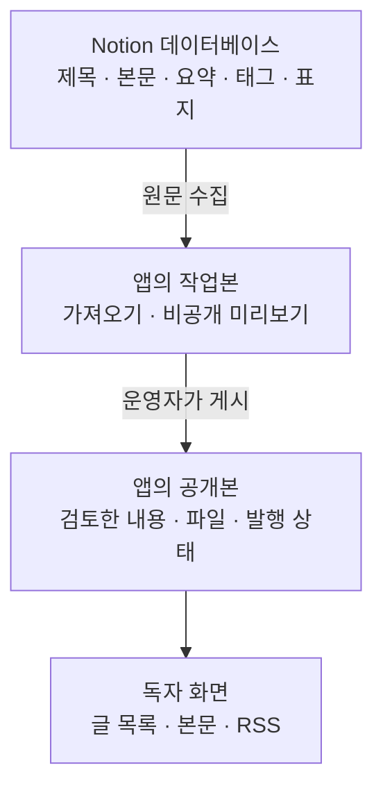
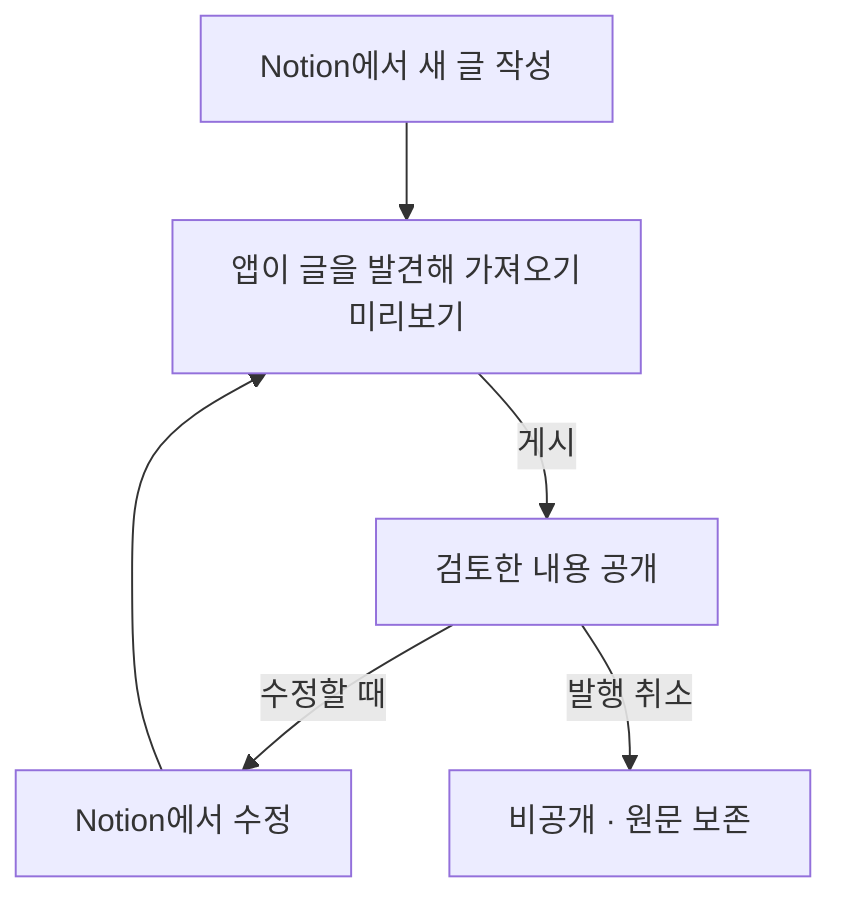
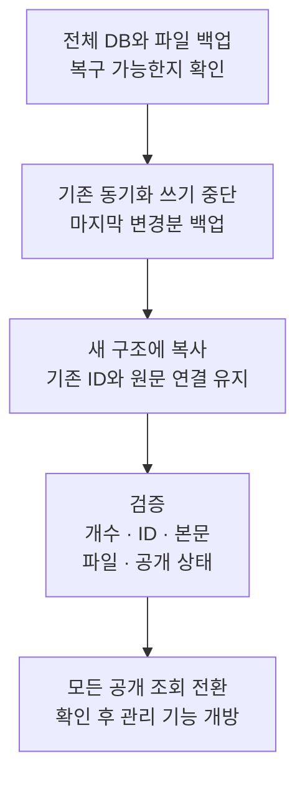

# Notion 블로그 전환 기획

**Notion에서 글을 쓰고, 앱에서 글 목록과 발행을 관리한다. 기존 데이터와 Notion의 기본 디자인은 유지한다.**

그림과 화면 확인을 포함해 **약 10분 안에 검토하는** 기획·구현 안내다. 글은 Notion에서 직접 만들고 고치며, 공개 여부는 앱의 관리 기능과 저장된 발행 상태만으로 결정한다.

## 1 역할 분담

**Notion은 글을 쓰고 고치는 유일한 곳이고, 앱은 글을 찾아 가져와 공개할 내용을 결정하는 곳이다.** 새 글 작성과 제목·본문 수정은 모두 Notion에서 한다. 앱은 Notion 페이지를 만들거나 고치지 않으며 글 관리 화면에서 Notion 편집 링크만 제공한다. 행 하나가 글 하나이며, 본문의 자식 페이지나 링크를 따라 새 글을 자동 등록하지 않는다.

현재 앱도 PostgreSQL에 수집한 내용을 저장한다. 이를 재사용하되, 문서 트리에서 공개 범위를 찾는 처리를 개별 게시글 관리로 바꾼다. **발행 상태·공개본·식별자는 앱에 남으므로 PostgreSQL은 지워도 되는 캐시가 아니다.** Notion 페이지 자체의 웹 공개 여부는 새 블로그의 발행 조건으로 쓰지 않는다.

## 2 작성과 발행 흐름

**Notion에 저장했다고 곧바로 공개되지 않는다.** 앱이 새로 발견한 글은 초안이다. 기존 글을 수정하는 동안 독자는 이전 공개본을 읽고, 앱에서 변경사항을 게시한 뒤 새 내용을 읽는다. 제목·요약·태그·표지도 같은 판본을 사용한다.

미리보기 이후 변경을 발견하면 다시 가져와 검토한다. 가져오기나 파일 준비에 실패하면 새 작업본을 저장하지 않고 기존 공개본을 유지한다. **게시는 앱에 저장된 검토본을 대상으로 하며, 발행 취소는 Notion 장애 중에도 가능하다.** 취소 이후 목록·본문·RSS·앱 보관 파일 요청은 차단하지만 이미 전달된 사본까지 회수할 수는 없다.

## 3 화면은 익숙한 Notion 그대로

**공개·관리 화면 모두 Notion의 일반적인 문서·데이터베이스 스타일을 유지한다.** 밝은 바탕, 회색 구분선, 기본 산세리프 글꼴, 여백 있는 본문, 페이지 제목과 속성을 사용한다. 어두운 모드도 같은 구조다. 별도 브랜드 색, 장식적인 카드, 세리프 글꼴은 추가하지 않는다.

| 화면 | 기본 형태 | 핵심 행동 |
| --- | --- | --- |
| 공개 홈 | 간결한 Notion 글 목록 | 제목·요약·게시일 확인, 페이지 이동 |
| 공개 글 | Notion 문서의 제목·속성·본문 블록 | 읽기, 목록으로 이동, RSS |
| 글 관리 | 제목·상태·최근 변경을 보여주는 테이블 | 상태 필터, Notion에서 열기 |
| 미리보기 | 공개 글과 같은 본문에 관리 동작 추가 | 가져오기, 게시, 발행 취소 |

모바일에서는 사이드바를 접고 제목·상태·주요 버튼을 먼저 보여준다. 코드·표를 제외하면 화면 전체를 가로로 밀어 읽지 않게 한다. 초안과 미리보기는 로그인한 운영자에게만 제공한다.

**[화면 예시 열기](https://chatgpt.com/space/page_cddfadb7eec48191b7c296f846dd0aaa)**에서 공개 홈·글 관리·미리보기를 전환할 수 있다. 샘플 데이터로만 동작하며 화면 원본은 [screens.html](screens.html)이다.

## 4 기존 데이터는 전부 보존

**새 목록에 넣을지 결정하는 것과 데이터를 보존하는 것은 별개다.** 모든 저장된 글·원문 연결·공개와 비공개 상태·스냅샷·공개 범위 이력·사이트 설정·헤더와 푸터 콘텐츠를 보존한다. 이번 전환에서 기존 테이블·이력이나 Notion 원문을 삭제하지 않는다.

**기존 글 ID·주소·RSS 식별자·최초 게시일을 유지한다.** 현재 공개된 글은 같은 주소로 읽을 수 있고, 비공개 글은 공개되지 않는다. 홈은 글 목록으로 바꾸되 기존 루트 문서 내용은 기존 글 주소와 탐색 링크로 접근하게 한다. 새 데이터 소스 밖에 남는 기존 문서는 호환 문서로 유지한다. 헤더·푸터도 현재 공개된 콘텐츠와 필요한 링크만 새 화면에 이어 붙인다.

Notion 페이지는 가능한 한 기존 ID를 유지해 연결한다. ID가 달라지면 이전·새 ID 대응표를 남긴다. 본문은 스냅샷 해시로, 파일은 실제 바이트로 대조한다. **회수하지 못한 이미지·첨부가 있으면 보존 완료로 처리하지 않고 전환을 보류한다.** Notion 임시 파일 URL은 영구 보관 수단이 아니다. [Notion 파일 문서](https://developers.notion.com/reference/file-object)

검증에 실패하면 현재 서비스를 유지한다. 새 관리 기능을 연 뒤 되돌릴 때도 이후의 발행 취소 기록을 지킨다. 구형 앱과 백업만 무조건 복원해 비공개 글을 다시 공개하지 않는다.

## 5 코드 변경

| 구분 | 변경 내용 |
| --- | --- |
| 재사용 | Kotlin·Spring MVC·Thymeleaf, 본문 렌더러·스냅샷·Notion 스타일 |
| 교체 | 트리 기반 공개 범위 → 글별 발행 상태, 단일 스냅샷 → 작업본·공개본, 홈 → 글 목록 |
| 신규 | 관리자 인증, 관리·미리보기·발행 명령, Notion 글 발견·가져오기, 파일 보관 |
| 이관 | 기존 데이터를 유지하는 추가 마이그레이션, 같은 공개 기준을 쓰는 목록·본문·RSS·파일 조회 |

목록·본문·RSS·파일 조회를 글별 발행 기준으로 전환하고 트리 기반 공개 동기화를 제거한다. **코드를 제거해도 기존 데이터와 이력은 남긴다.** V1~V7은 유지하고 V8로 새 테이블을 추가한다. 앱 시작 시 아직 이전되지 않은 글만 복사하므로 재시작이 운영자의 발행 취소를 되돌리지 않는다.

구현 순서는 **데이터 보존 기반 → 작업본·공개본 분리 → 인증·미리보기·파일 보관 → 발행 명령 → 공개 조회 전환**이다. 관리 기능은 모든 공개 조회가 새 기준을 따르는 것을 확인한 뒤 연다. 트리 탐색은 단순해지지만 관리 기능이 추가되므로 전체 코드량 감소까지 보장하지는 않는다.

## 6 놓치면 안 되는 조건

**장애가 데이터를 지우지 않게 한다.** 일부 목록 누락·권한 오류·타임아웃을 삭제로 판단하지 않는다. 공개 여부는 앱의 발행·발행 취소·보관 명령과 저장된 발행 상태만 결정한다. Notion의 공개 설정·휴지통·이동·권한·접근 불가는 원본 진단만 갱신하며 발행 상태와 기존 공개 스냅샷을 바꾸지 않고, 저장 데이터는 남긴다. 긴급 중지는 앱에서 한다.

**초안이 새어 나오지 않게 한다.** 관리 화면·미리보기·초안 파일에 인증을 적용한다. 공개 파일도 해당 글의 공개 상태를 확인하며, 비공개 Notion 링크를 독자 화면에 그대로 내보내지 않는다.

관리 변경 요청에는 CSRF 방어를 적용한다. 파일 수집은 사설망 접근·위험한 리다이렉트·크기 초과를 차단한다.

**같은 글을 중복 등록하지 않는다.** 한 Notion 페이지는 하나의 글 ID에만 연결한다. 앱에서 Notion 페이지를 만드는 요청은 없다. 페이지네이션을 끝내지 못한 목록은 전체 결과로 취급하지 않는다. [Notion 요청 처리](https://developers.notion.com/reference/request-limits) · [목록 조회](https://developers.notion.com/reference/query-a-data-source)

## 7 첫 출시와 완료 기준

첫 출시는 **한 블로그·한 운영자**를 기준으로 공개 목록·글·RSS, 관리 목록, Notion 글 가져오기, 미리보기, 발행·발행 취소·보관을 제공한다. 앱에는 글 작성·편집 기능을 두지 않는다. 댓글, 예약 발행, 다중 작성자, 새 slug 주소는 후속 범위다.

완료 기준은 네 가지다. **기존 데이터와 주소가 보존되는가, Notion 수정이 자동 공개되지 않는가, 발행 취소가 모든 공개 경로에 적용되는가, 전체 화면이 Notion 기본 디자인을 유지하는가.** 이 조건을 충족한 뒤 관리 기능을 개방한다.

운영자는 **고정 아이디·비밀번호 폼 로그인**으로 인증하고 파일은 **PostgreSQL에 바이트로 보관**한다. 로그인 설정이 없으면 관리 화면은 닫힌다. 운영 전 실제 Notion 데이터 소스·속성 ID와 관리자 아이디·비밀번호를 설정한다. [설정과 실행 안내](../../../README.md)

---

코드 근거: [현재 업무 규칙](../../ddd-architecture.md#현재-업무-규칙), [Post](../../../src/main/kotlin/xyz/robinjoon/notionblog/blog/domain/post/Post.kt), [수집 반영](../../../src/main/kotlin/xyz/robinjoon/notionblog/blog/application/service/ApplyImportedPostService.kt), [공개 조회](../../../src/main/kotlin/xyz/robinjoon/notionblog/blog/application/service/GetPublicPostService.kt).

검증 결과: Notion 글 생성 기능을 제거하고 주석을 한국어로 정리한 뒤 전체 Gradle `build`를 통과했다. 앱 테스트 **1,239개**와 품질 규칙 테스트 **36개**가 모두 통과했고, API 문서의 실행 JAR 포함도 확인했다. 빌드·캐시 경로만 임시 디렉터리로 분리했으며 검사 제외는 없다. **운영 데이터 이관·배포는 수행하지 않았다.** 운영 전 백업·파일 회수·공개 상태 대조를 완료해야 하며, 상세 절차는 [배포 문서](../../deployment.md)를 따른다.

**V8을 이미 적용한 DB에서는 주석 번역으로 Flyway 체크섬 검증이 실패할 수 있다.** 실제 DB의 V8 적용 이력은 확인하지 않았으며 자동 repair나 검증 완화는 수행하지 않았다. V1~V7과 V8의 SQL 실행문은 그대로다.
